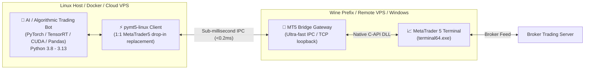

# 🚀 pymt5-linux

> **The Modern, High-Performance MetaTrader 5 SDK & 1:1 Drop-in Replacement for Linux**  
> *Seamlessly run your Python Algorithmic & AI Trading Bots on Linux, Wine, Docker, and Cloud VPS.*

[](https://github.com/renartacayle/pymt5-linux/actions)
[](https://pypi.org/project/pymt5-linux/)
[](https://opensource.org/licenses/MIT)
[](https://github.com/psf/black)
[](https://github.com/renartacayle/pymt5-linux/pulls)
[](https://github.com/renartacayle/pymt5-linux)

---

## ⚡ The Problem: MetaTrader 5 on Linux is Broken

Every quantitative researcher and algorithmic trader who deploys bots to Linux VPS or Cloud servers encounters this barrier:
```bash
$ pip install MetaTrader5
ERROR: Could not find a version that satisfies the requirement MetaTrader5
ERROR: No matching distribution found for MetaTrader5 (Windows only wheels)
```

The official MetaQuotes `MetaTrader5` Python package only distributes compiled Windows C-extension wheels (`.pyd` binary DLLs).

**Until now, your only choices were painful:**
- ❌ Renting expensive Windows Servers (\$15–\$30/mo) just to execute MT5 trades.
- ❌ Trying to run PyTorch, TensorFlow, and CUDA inside Wine (slow, unstable, near-impossible GPU acceleration).
- ❌ Installing flaky, unmaintained ZeroMQ Expert Advisors (EAs) that crash and lack standard MT5 function parity.

---

## 💡 The Solution: `pymt5-linux`

**`pymt5-linux`** is a complete, production-grade MetaTrader 5 SDK architected specifically for Linux. It delivers a **1:1 drop-in replacement API** for existing Python trading scripts, while keeping your AI models running natively on Linux with full GPU/CUDA speed!



---

## ✨ Key Features

- 🔄 **1:1 Drop-in Replacement:** Simply replace `import MetaTrader5 as mt5` with `import pymt5_linux as mt5`. Zero code changes required!
- 🏎️ **Sub-Millisecond Latency:** Local IPC / TCP loopback latency is `< 0.2 ms`, completely negligible compared to broker network ping (15–50 ms).
- 🧠 **Native GPU & AI Acceleration:** Run your heavy PyTorch, TensorFlow, RL, or LightGBM models natively on Linux with CUDA / ROCm.
- 🐼 **First-Class Pandas & NumPy Integration:** Native conversion helpers like `copy_rates_from_pos_df()` returning ready-to-use DataFrames with UTC datetime indices.
- ⚡ **Modern Async API (`AsyncMetaTrader5`):** Full non-blocking `async`/`await` support for high-throughput concurrent trading bots.
- 📡 **Real-time Event Streaming (`MT5Streamer`):** Subscribe to live price ticks and candle updates with event callbacks.
- 🧪 **Built-in Mock Simulator Engine:** Instant local testing, strategy backtesting, and CI/CD pipelines without needing Wine or MT5 running.
- 🛠️ **Headless & Wine CLI Tool:** One command to check status, start gateways, and launch virtual displays (`Xvfb`).

---

## 📊 Feature Comparison Matrix

| Feature | Official `MetaTrader5` | ZeroMQ EA Bridges | **`pymt5-linux`** |
| :--- | :---: | :---: | :---: |
| **Linux Native Execution** | ❌ Fails to install | ⚠️ Partial | **✅ 100% Native** |
| **Drop-in MT5 API Parity** | ✅ (Windows only) | ❌ Incompatible | **✅ 100% Drop-in** |
| **GPU / CUDA AI Support** | ❌ (Wine issues) | ⚠️ Clunky | **✅ Native Linux Speed** |
| **Pandas DataFrame Support** | ⚠️ Manual conversion | ❌ Manual | **✅ `copy_rates_from_pos_df()`** |
| **Asyncio (`async`/`await`)**| ❌ No | ❌ No | **✅ Built-in (`AsyncMetaTrader5`)** |
| **Built-in Mock Simulator** | ❌ No | ❌ No | **✅ Complete In-Memory Engine** |
| **Event-Driven Streaming** | ❌ Polling only | ⚠️ Unstable | **✅ Clean Event Callbacks** |
| **Zero-MQL5 Terminal Setup**| ❌ (Windows only) | ❌ Complex EA compilation | **✅ Automatic Gateway** |

---

## 📦 Installation

```bash
pip install pymt5-linux
```

Optional dependencies for data science and development:
```bash
pip install "pymt5-linux[dev]"
```

---

## 🚀 Quickstart in 30 Seconds

### 1. Drop-in Replacement (Sync API)

```python
import pymt5_linux as mt5

# Connect to MT5 (auto-detects local gateway or spins up local simulator)
if not mt5.initialize():
    print(f"Failed to initialize: {mt5.last_error()}")
    quit()

# 1. Inspect Account
acct = mt5.account_info()
print(f"Connected: Login {acct.login} | Balance: {acct.balance} {acct.currency} | Equity: {acct.equity}")

# 2. Fetch Market Data directly into Pandas DataFrame
df = mt5.copy_rates_from_pos_df("EURUSD", mt5.TIMEFRAME_M5, start_pos=0, count=100)
print(df.tail())

# 3. Execute Trade
request = {
    "action": mt5.TRADE_ACTION_DEAL,
    "symbol": "EURUSD",
    "volume": 0.1,
    "type": mt5.ORDER_TYPE_BUY,
    "price": mt5.symbol_info_tick("EURUSD").ask,
    "sl": 1.08000,
    "tp": 1.09500,
    "comment": "AI Bot Buy Order",
    "magic": 100001
}
result = mt5.order_send(request)
print(f"Order executed! Ticket: {result.order}, Deal: {result.deal}")

# 4. View Open Positions
positions = mt5.positions_get(symbol="EURUSD")
for pos in positions:
    print(f"Position #{pos.ticket}: {pos.symbol} {pos.volume} lots | Profit: {pos.profit}")

mt5.shutdown()
```

---

### 2. High-Performance Async Trading (`AsyncMetaTrader5`)

```python
import asyncio
from pymt5_linux import AsyncMetaTrader5, TIMEFRAME_M1

async def main():
    mt5 = AsyncMetaTrader5(host="127.0.0.1", port=18812)
    await mt5.initialize()

    # Concurrent fetch
    acct, tick, df = await asyncio.gather(
        mt5.account_info(),
        mt5.symbol_info_tick("BTCUSD"),
        mt5.copy_rates_from_pos_df("BTCUSD", TIMEFRAME_M1, 0, 50)
    )

    print(f"BTC/USD Bid: {tick.bid} | Ask: {tick.ask}")
    print(f"Candles shape: {df.shape}")
    await mt5.shutdown()

asyncio.run(main())
```

---

### 3. Real-Time Tick Streaming (`MT5Streamer`)

```python
import time
from pymt5_linux import default_client as mt5, MT5Streamer

mt5.initialize()
streamer = MT5Streamer(mt5, poll_interval=0.05)

@streamer.on_tick("EURUSD")
def on_eurusd_tick(tick):
    print(f"[EURUSD] Bid: {tick.bid:.5f} | Ask: {tick.ask:.5f} | Time: {tick.time}")

@streamer.on_tick("BTCUSD")
def on_btc_tick(tick):
    print(f"[BTCUSD] Bid: ${tick.bid:,.2f}")

streamer.start()

try:
    while True:
        time.sleep(1)
except KeyboardInterrupt:
    streamer.stop()
    mt5.shutdown()
```

---

## 🖥️ Command-Line Interface (CLI)

`pymt5-linux` comes with a powerful diagnostic and server CLI:

```bash
# Check Wine, Xvfb, MT5 terminals, and gateway connectivity
pymt5-linux status

# Start standalone Mock Simulator Server (ideal for local testing / CI)
pymt5-linux mock --port 18812 --balance 50000

# Benchmark connection and latency
pymt5-linux test-connect --port 18812
```

---

## 🐧 Deploying on Ubuntu / Debian VPS

### 1. Install Wine & MT5 (Official Script)
```bash
wget https://download.mql5.com/cdn/web/metaquotes.software.corp/mt5/mt5ubuntu.sh
chmod +x mt5ubuntu.sh
./mt5ubuntu.sh
```

### 2. Install Headless Display (Xvfb)
On servers without a GUI:
```bash
sudo apt install xvfb -y
Xvfb :99 -screen 0 1024x768x16 -ac &
export DISPLAY=:99
wine ~/.wine/drive_c/Program\ Files/MetaTrader\ 5/terminal64.exe &
```

### 3. Install Python inside Wine & Launch Gateway
```bash
wget https://www.python.org/ftp/python/3.11.8/python-3.11.8-amd64.exe
wine python-3.11.8-amd64.exe /quiet InstallAllUsers=1 PrependPath=1
wine python -m pip install MetaTrader5 pymt5-linux

# Start bridge gateway inside Wine
wine python -m pymt5_linux.cli gateway --port 18812
```

Now your AI trading bot on the Linux host connects to `127.0.0.1:18812` seamlessly!

---

## 🐳 Docker Deployment

Run your complete MT5 trading stack in a single container with Docker Compose:

```yaml
version: '3.8'

services:
  mt5-gateway:
    image: renartacayle/pymt5-linux:latest
    ports:
      - "18812:18812"
    environment:
      - DISPLAY=:99
    restart: always

  ai-bot:
    build: .
    depends_on:
      - mt5-gateway
    environment:
      - MT5_HOST=mt5-gateway
      - MT5_PORT=18812
```

---

## 🤝 Contributing

Contributions, issues, and feature requests are welcome!
Feel free to check the [issues page](https://github.com/renartacayle/pymt5-linux/issues).

1. Fork the Project
2. Create your Feature Branch (`git checkout -b feature/AmazingFeature`)
3. Commit your Changes (`git commit -m 'Add some AmazingFeature'`)
4. Push to the Branch (`git push origin feature/AmazingFeature`)
5. Open a Pull Request

---

## 📜 License

Distributed under the MIT License. See [`LICENSE`](./LICENSE) for more information.

---

## ⭐ Show Your Support

If this library saved your trading bot setup on Linux, give a ⭐️ on [GitHub](https://github.com/renartacayle/pymt5-linux)!
